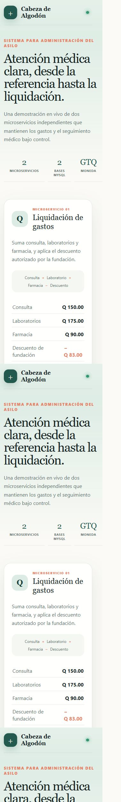

# Sistema del Asilo Cabeza de Algodón

Proyecto del curso **Análisis de Sistemas II** para administrar la información clínica, operativa y financiera del Asilo Cabeza de Algodón.

El repositorio contiene un prototipo web compuesto por una interfaz en Nginx, tres servicios REST desarrollados con Node.js y TypeScript, y tres bases de datos MySQL independientes.



## Estado actual

Funcionan en el prototipo:

- Registro y consulta de residentes y fichas médicas.
- Órdenes y resultados de laboratorio.
- Inventario y entrega de medicamentos.
- Caja, cuotas y donaciones.
- Referencias médicas y seguimiento de estados.
- Cálculo y anulación de liquidaciones médicas.
- Panel e indicadores básicos.

Pendiente de implementar:

- Inicio de sesión y autorización por roles.
- Usuarios de prueba funcionales.
- Especificación OpenAPI y Swagger UI.
- Pruebas integrales, de seguridad y de aceptación ampliadas.
- Despliegue público con HTTPS, respaldos y monitoreo.

## Arquitectura

| Componente | Tecnología | Puerto local |
| --- | --- | ---: |
| Interfaz web | HTML, CSS, JavaScript y Nginx | 8080 |
| Servicio de gastos médicos | Node.js, TypeScript y Express | 3001 |
| Servicio de referencias | Node.js, TypeScript y Express | 3002 |
| Servicio administrativo | Node.js, TypeScript y Express | 3003 |
| Base de gastos | MySQL 8 | 3307 |
| Base de referencias | MySQL 8 | 3308 |
| Base administrativa | MySQL 8 | 3309 |

## Requisitos

- Windows 10 u 11.
- Docker Desktop con Docker Compose.
- Puertos 8080, 3001, 3002, 3003, 3307, 3308 y 3309 disponibles.
- Node.js 20 o posterior solo para ejecutar compilaciones y pruebas fuera de Docker.

## Inicio rápido en Windows

1. Descarga o clona el repositorio.
2. Abre Docker Desktop y espera a que el motor esté listo.
3. Ejecuta `ABRIR_APLICACION.cmd`.
4. Espera a que los contenedores aparezcan como saludables.
5. Abre [http://localhost:8080](http://localhost:8080).

Como alternativa, `INICIAR_DEMO.cmd` inicia el entorno sin abrir el navegador.

Para verificar la demostración ejecuta `VERIFICAR_DEMO.cmd`. Para detener exclusivamente los contenedores del proyecto ejecuta `DETENER_DEMO.cmd`.

### Inicio con Docker Compose

```bash
docker compose up --build -d
```

Para detener el entorno:

```bash
docker compose down
```

## Direcciones locales

| Recurso | URL |
| --- | --- |
| Aplicación web | <http://localhost:8080> |
| Salud del servicio de gastos | <http://localhost:3001/health> |
| Salud del servicio de referencias | <http://localhost:3002/health> |
| Salud del servicio administrativo | <http://localhost:3003/health> |
| API de liquidaciones | <http://localhost:3001/api/v1/liquidations> |
| API de referencias | <http://localhost:3002/api/v1/referrals> |
| API administrativa | <http://localhost:3003/api/v1> |

## Regla de descuento de demostración

La demostración utiliza un descuento del 20 %, configurable entre 0 y 100. Se aplica al total de consulta, laboratorio y farmacia. La cuota mensual del asilo se registra como movimiento de caja y no se incluye en la liquidación médica.

Los montos se calculan en centavos enteros y el descuento se redondea al centavo más cercano. Por ejemplo: consulta Q150, laboratorio Q175 y farmacia Q90 producen un total bruto de Q415, un descuento de Q83 y un total a pagar de Q332.

## Pruebas y compilación

Desde cada servicio se pueden instalar dependencias y ejecutar las tareas disponibles:

```bash
npm ci
npm run build
npm test --if-present
```

Los servicios de gastos y referencias incluyen pruebas unitarias. El servicio administrativo actualmente solo dispone de compilación TypeScript.

## Documentación de la API

La colección de Postman se encuentra en [`postman/Asilo-Cabeza-de-Algodon.postman_collection.json`](postman/Asilo-Cabeza-de-Algodon.postman_collection.json).

Documentación adicional:

- [`docs/FRONTEND.md`](docs/FRONTEND.md)
- [`docs/PRUEBAS_CURL.md`](docs/PRUEBAS_CURL.md)
- [`docs/GUIA_VIDEO.md`](docs/GUIA_VIDEO.md)

## Estructura principal

```text
administration-service/       API de residentes, clínica, farmacia y caja
medical-expense-service/      API de liquidaciones y descuentos
medical-referral-service/     API de referencias médicas
demo-ui/                      Interfaz web y proxy Nginx
postman/                      Colección para probar las APIs
examples/                     Cuerpos JSON de ejemplo
scripts/                      Inicio, verificación y detención en Windows
docs/                         Guías del prototipo
docker-compose.yml            Orquestación del entorno completo
```

## Seguridad

Las contraseñas incluidas en `.env.example` y en los valores predeterminados de Docker Compose son exclusivamente para la demostración local. No deben utilizarse en producción.

Los archivos `.env`, claves privadas, dependencias, compilados y datos locales de MySQL están excluidos del repositorio. Antes de un despliegue real deben configurarse secretos independientes, HTTPS, control de acceso, respaldos y auditoría.

## Curso

- Asignatura: Análisis de Sistemas II.
- Proyecto: Sistema para el Asilo Cabeza de Algodón.
- Estado documentado: 10 de octubre de 2026.
