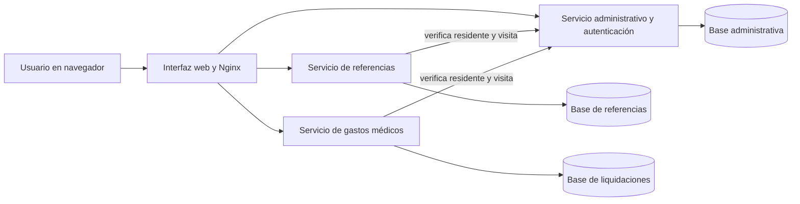
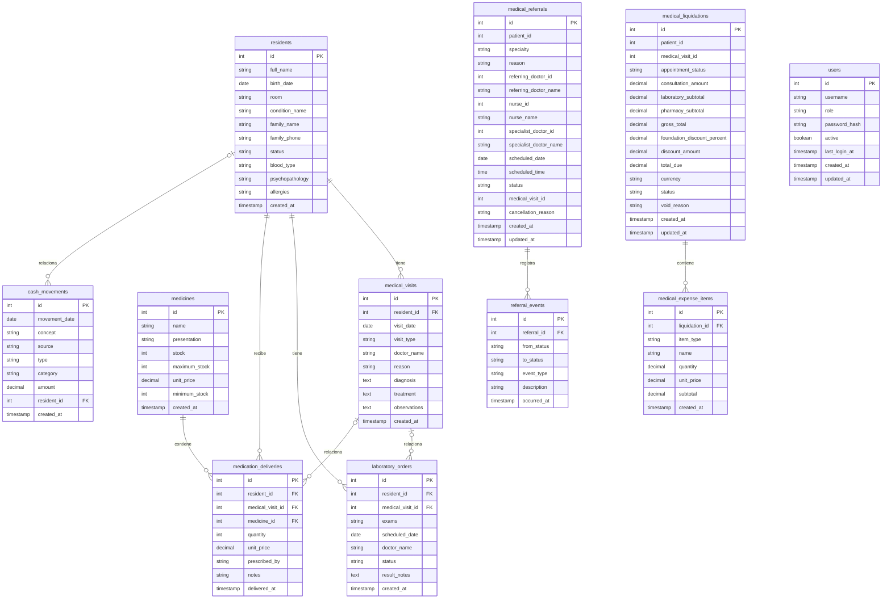

# Arquitectura y modelo de datos

Documento del prototipo local. Las flechas del diagrama de componentes representan comunicación; cada servicio utiliza su propia base de datos.

## Entidades y relaciones en las bases de datos

Las líneas representan claves foráneas existentes dentro de cada base. Los identificadores de paciente o visita almacenados en otras bases son referencias lógicas sin clave foránea entre bases; los servicios verifican los nuevos vínculos mediante el servicio administrativo.

Para ver todos los campos y restricciones, consultar los archivos `database/init.sql` de cada servicio. Las cuentas están en la base administrativa; los servicios verifican las sesiones firmadas mediante una clave compartida.

## Limitación importante

La conversión de una referencia vincula una visita ya registrada y comprueba que pertenezca al residente; no crea una visita. Las nuevas liquidaciones también validan el residente y su visita. Los registros anteriores no se corrigen automáticamente y el estado de cita de la liquidación sigue siendo proporcionado por el usuario. Las bases son independientes, por lo que la consulta no constituye una transacción distribuida. Se requieren pruebas completas de integración y aceptación antes de usar datos reales.
