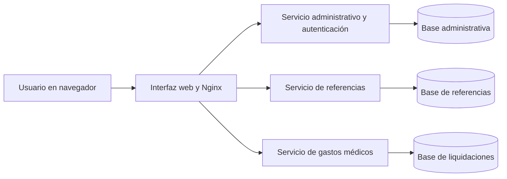
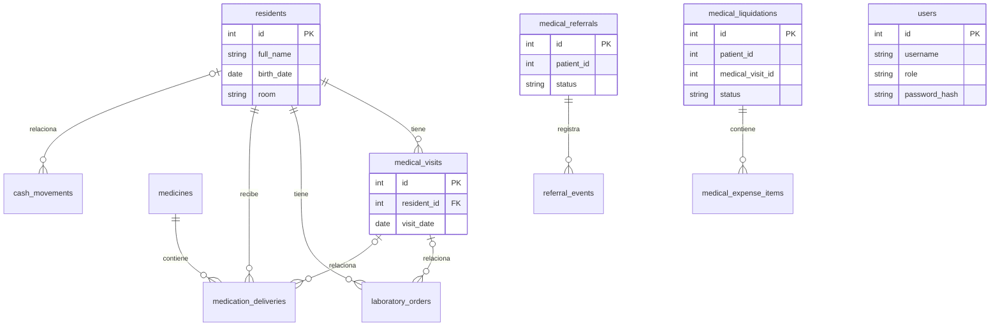

# Arquitectura y modelo de datos

Documento del prototipo local. Las flechas del diagrama de componentes representan comunicación; cada servicio utiliza su propia base de datos.

## Entidades y relaciones en las bases de datos

Las líneas representan claves foráneas existentes dentro de cada base. Los identificadores de paciente o visita almacenados en otras bases son referencias lógicas: actualmente no tienen una clave foránea ni verificación automática entre servicios.

Para ver todos los campos y restricciones, consultar los archivos `database/init.sql` de cada servicio. Las cuentas están en la base administrativa; los servicios verifican las sesiones firmadas mediante una clave compartida.

## Limitación importante

La conversión de una referencia registra el identificador de una visita, pero no crea ni verifica que exista o que pertenezca al paciente. Las liquidaciones tampoco verifican esos identificadores contra la base administrativa. Esta integración debe completarse y probarse antes de considerar el sistema listo para datos reales.
