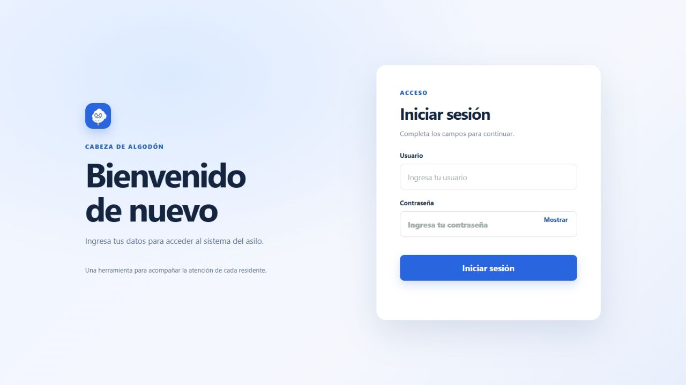
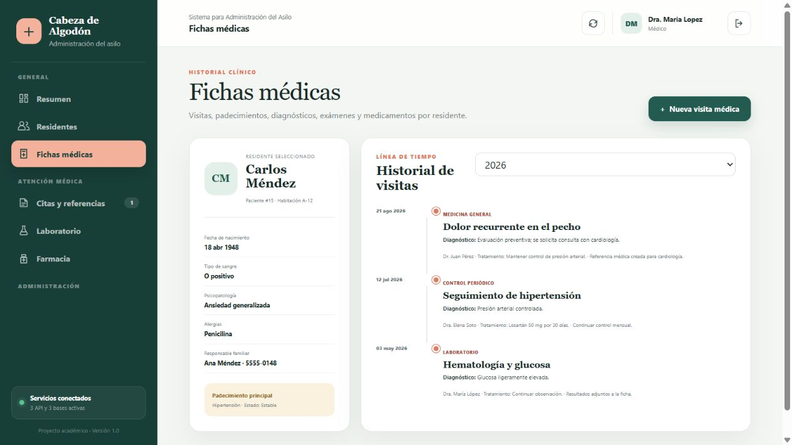
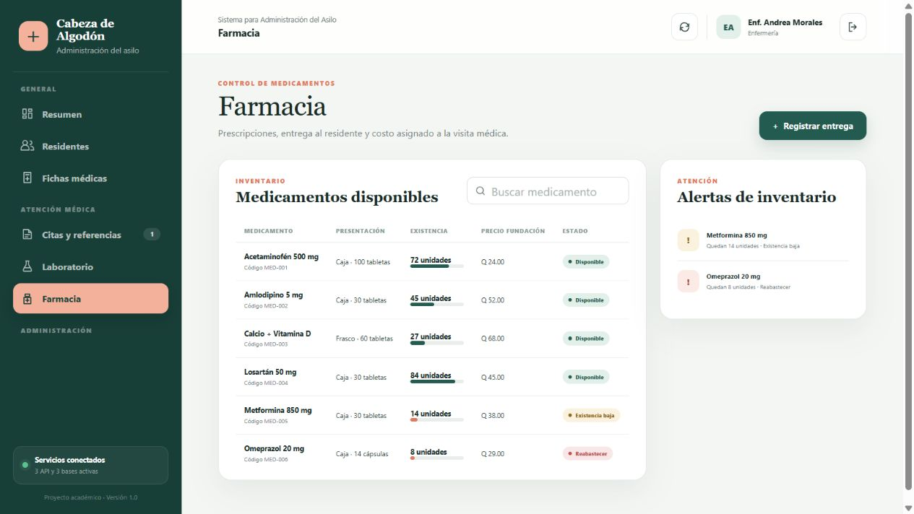
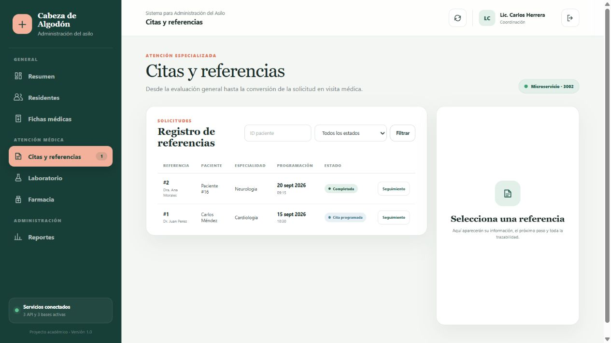
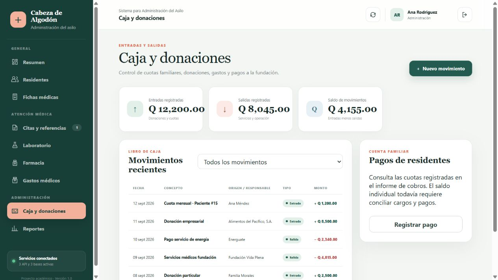

# Manual de usuario y manual técnico

## Manual de usuario

1. Inicie Docker Desktop, abra el proyecto con `ABRIR_APLICACION.cmd` y espere a que los servicios estén disponibles. Entre a `http://localhost:8080`.
2. Escriba su usuario y contraseña. Para la demostración local, las cuentas ficticias están en el README. Las opciones disponibles dependen del rol asignado.
3. En **Residentes**, consulte la lista y seleccione una persona para ver su expediente. Administración puede registrar residentes; el personal autorizado puede registrar visitas.
4. En **Laboratorio** gestione las órdenes y resultados; en **Farmacia**, consulte existencias y registre entregas según su rol. Los medicamentos sin existencia se muestran como necesidad de reabastecimiento.
5. En **Referencias**, consulte el seguimiento y realice la acción permitida para su rol y el estado actual. Vincular una visita exige introducir el identificador de una visita ya registrada para el mismo residente. La vinculación no crea la visita.
6. En **Gastos médicos**, introduzca los identificadores, importes y descuentos, calcule y luego guarde la liquidación si corresponde. El sistema comprueba que el residente exista y que la visita le pertenezca. El estado de cita se indica manualmente y todavía no se verifica con una referencia.
7. Consulte los movimientos en **Caja** y los informes en **Reportes**, según los permisos de su cuenta. Para terminar, use **Cerrar sesión**.

No utilice información personal real en esta demostración. La matriz de permisos está en `AUTENTICACION_Y_ROLES.md`.

### Inicio de sesión

Ingrese el usuario y contraseña de su cuenta de prueba. Use **Mostrar** si necesita revisar la contraseña escrita. Después de ingresar, el menú y las acciones se ajustan al rol. Los ejemplos de las capturas son datos ficticios de demostración.

### Médico

En **Residentes**, elija a la persona y abra **Fichas médicas** para consultar su historial. Con **Nueva visita médica**, complete fecha, motivo y diagnóstico; el médico se toma automáticamente de la sesión. Para solicitar una atención especializada, use **Nueva referencia**, indique el residente, la especialidad y el motivo. También puede crear órdenes de laboratorio y consultar farmacia. No tiene acceso a caja ni a reportes financieros.

### Enfermería

Consulte el expediente y las órdenes de laboratorio; registre resultados cuando estén disponibles. En **Farmacia**, revise existencias y use **Registrar entrega** para documentar los medicamentos entregados. En **Citas y referencias**, abra el seguimiento de la solicitud y, cuando corresponda a su estado, registre el inicio del traslado o la atención. Estas acciones solo se habilitan en el paso adecuado.

### Coordinación

En **Citas y referencias**, seleccione **Seguimiento** para ver el estado y la trazabilidad. Según el paso, puede asignar enfermero, programar o reprogramar una cita, cancelar o vincular una visita ya registrada para ese residente. En **Reportes** puede consultar informes clínicos y de servicios. El informe **Donaciones y cobros** muestra únicamente los totales generales de ingresos, gastos y saldo, sin aplicar filtros ni mostrar movimientos individuales. Caja, liquidaciones y detalles financieros son exclusivos de Administración.

### Administración

En **Residentes**, registre los datos del residente y su familiar responsable. En **Caja y donaciones**, use **Nuevo movimiento** para registrar ingresos o salidas y consulte los movimientos existentes. En **Gastos médicos**, ingrese el residente y la visita existente, agregue los importes, calcule y guarde la liquidación; también puede consultar o anular una liquidación según corresponda. En **Reportes**, aplique filtros antes de consultar o imprimir.

## Manual técnico

El sistema utiliza una interfaz HTML/CSS/JavaScript servida por Nginx y tres API Express/TypeScript, cada una con MySQL. La arquitectura y el modelo de datos están en `ARQUITECTURA_Y_DATOS.md`.

Se necesita Docker Desktop y los puertos indicados en el README. Desde la raíz del proyecto, `docker compose up --build -d` construye e inicia el entorno; `docker compose ps` muestra el estado y `docker compose logs` permite revisar errores. `docker compose down` detiene los contenedores; no incluya la opción de eliminar volúmenes si desea conservar los datos.

Cada servicio contiene sus dependencias y scripts. Para verificarlo fuera de Docker, ejecute `npm ci`, `npm run build` y `npm test` dentro de su carpeta. Las rutas y ejemplos de la API están en el README y en la colección de Postman.

El entorno contiene cuentas ficticias y secretos de demostración. Antes de cualquier uso real se necesitan gestión segura de cuentas y secretos, HTTPS, respaldos, auditoría y pruebas de integración y aceptación. En particular, cambiar `AUTH_JWT_SECRET` y retirar o deshabilitar las cuentas de prueba es obligatorio. No publicar el entorno local tal como está.
